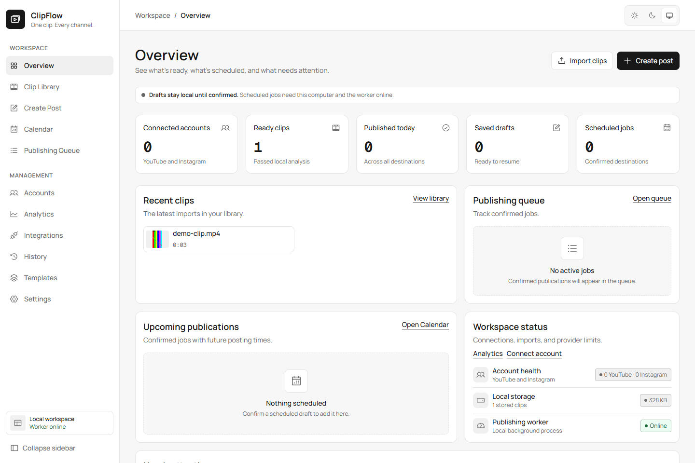

# ClipFlow

**One clip. Every channel.**

ClipFlow is a local publishing workspace for creators who manage multiple YouTube channels or Instagram professional accounts. Drop in an MP4, prepare your metadata, and send it to the accounts you choose. A background worker tracks uploads, scheduled jobs, and provider confirmations.

Your drafts, media, and publishing history live on your computer. Use your own provider accounts and credentials. The dashboard runs on loopback and requires no ClipFlow account.

## Features

| Area | What ClipFlow supports |
| --- | --- |
| Library | Manual MP4 uploads, previews and thumbnails, local storage, and reimporting published clips |
| Publishing | Multiple YouTube channels, Instagram Reels through eligible professional accounts, bulk destinations, immediate or scheduled jobs, and a persistent queue |
| Content | Manual titles, descriptions and captions, Gemini metadata suggestions, optional AssemblyAI audio transcription, reusable templates, account groups, and publishing presets |
| Operations | A background worker, eligible job retries, text publication history, and optional cleanup of verified local copies |
| Analytics | YouTube channel reports and performance graphs for authorized accounts |
| Workspace | Integration Setup Center, keyboard-accessible controls, and light, dark, or system theme |

YouTube uploads and analytics require Google OAuth and the relevant APIs. Instagram Reels requires a linked Facebook Page, Meta app permissions, and a trusted local HTTPS callback. Instagram posting is covered by mocked tests and still needs live verification with an eligible Meta app. AI and transcription are optional.

## Screenshots

The screenshots in this section are captured from an isolated ClipFlow workspace with generated fixture media and synthetic accounts.



[View the post composer](docs/screenshots/composer.png)

## Prerequisites

- [Node.js 24 LTS](https://nodejs.org/en/download) and the npm version it includes. Keep development dependencies installed, since building and the migration launcher use them.
- [Git](https://git-scm.com/downloads).
- [FFmpeg and FFprobe](https://ffmpeg.org/download.html) on PATH for clip analysis, previews, and transcription. On Windows, download an FFmpeg Windows build, extract it, and add its `bin` folder to PATH. On macOS with Homebrew, run `brew install ffmpeg`. On Ubuntu or Debian, run `sudo apt install ffmpeg`. Check with `ffmpeg -version` and `ffprobe -version`. You can set executable paths in `.env.local` instead.
- A writable project directory on a local filesystem. SQLite and the per-installation encryption key need ordinary file access, including hard links for atomic key creation. Provider integrations need internet access.

The fresh install has been exercised on Windows. The implementation uses portable Node and FFmpeg interfaces and CI is configured for Ubuntu. Running on macOS requires the same local prerequisites.

## Install and run

```sh
git clone https://github.com/Sarif-02/ClipFlow.git
cd ClipFlow
npm ci
npm run db:deploy
npm run build
npm start
```

Open [http://localhost:3001](http://localhost:3001). `npm start` checks migrations and starts both the web app and publishing worker. Subsequent launches use `npm start`. Rebuild after updating source. Stop both processes with **Ctrl+C**. Use `npm run dev` when changing application code.

ClipFlow creates an empty SQLite database on first migration and generates a random installation key on first use. Local upload and drafting work before you connect providers. To override settings, copy [`.env.example`](.env.example) to `.env.local` with `cp .env.example .env.local` on macOS or Linux or `Copy-Item .env.example .env.local` in PowerShell. Restart after editing it.

| Setting | Default and use |
| --- | --- |
| `APP_URL` | `http://localhost:3001`. Use this exact origin in the browser and the registered Google callback. |
| `DATABASE_URL` | `file:./data/database/clipflow.db`. Choose a local SQLite file. |
| `STORAGE_PATH` | `./data`. Contains managed video, thumbnail, and staging copies. Changing paths does not move files. |
| `APP_TIMEZONE`, `MAX_UPLOAD_MIB` | `Asia/Kolkata` and 512 MiB. Change publishing defaults and the upload limit in **Integrations**. |
| `YOUTUBE_ANALYTICS_CACHE_HOURS` | 24 hours. |
| `FFMPEG_PATH`, `FFPROBE_PATH` | Resolved from PATH when blank. |
| `TOKEN_ENCRYPTION_KEY` | Generated per installation if blank. An override is a private random key of 64 hexadecimal characters. |
| Provider credentials | Optional. Prefer saving them under **Integrations**. The blank provider variables in the example are fallback credentials. |
| `META_TLS_CERT`, `META_TLS_KEY` | Only needed for Instagram OAuth. Point to the trusted localhost certificate and its private key. |

## Connect providers

### YouTube and YouTube Analytics

1. Create a project in Google Cloud. Enable **YouTube Data API v3** and **YouTube Analytics API**. [Google Cloud API library](https://console.cloud.google.com/apis/library)
2. Set up **Google Auth Platform** branding, audience, and data access. If an external project stays in **Testing**, add each Google account you will use as a test user. Refresh tokens for ClipFlow's scopes typically expire after seven days in that mode. [Google OAuth token expiration](https://developers.google.com/identity/protocols/oauth2#expiration)
3. Create a **Web application** OAuth client. Add `http://localhost:3001/api/oauth/youtube/callback` as an authorized redirect URI. If you change `APP_URL`, copy the exact callback shown in Integrations. [Google OAuth for web server apps](https://developers.google.com/identity/protocols/oauth2/web-server)
4. In ClipFlow's **Integrations → YouTube**, save the client ID and secret. Connect a YouTube account, select the intended channel or Brand Account, and grant the read, upload, and analytics permissions. Repeat for each channel. Test the connection and use **Analytics → Refresh** to fetch reports.

For an app that leaves Testing, check Google's verification requirements for its declared scopes and audience. Check the project quota in Google Cloud and configure ClipFlow's local limits to match. [OAuth verification](https://developers.google.com/identity/protocols/oauth2/production-readiness/overview) · [YouTube quotas and audits](https://developers.google.com/youtube/data/guides/quota_and_compliance_audits)

### Instagram Reels

1. Create an app in the Meta developer dashboard and configure Instagram API with **Facebook Login for Business**. Link a Creator or Business Instagram account to a Facebook Page you can manage.
2. Request `instagram_basic`, `instagram_content_publish`, `pages_show_list`, and `pages_read_engagement`. Meta's required access level and review depend on which accounts and Page roles use the app.
3. Register `https://localhost:3443/api/oauth/instagram/callback`. Set `META_TLS_CERT` and `META_TLS_KEY` to a locally trusted certificate for `localhost` and its key, restart, and open ClipFlow using `localhost`. The HTTPS listener serves only that callback on loopback. Meta configurations requiring public callbacks fall outside this setup.
4. In **Integrations → Instagram**, save your App ID, secret, supported Graph API version, and Login configuration ID if applicable. Connect the intended Page and test access before scheduling a Reel.

Follow the complete [local integration guide](docs/INTEGRATIONS.md#instagram-reels) and [Meta content publishing requirements](https://developers.facebook.com/documentation/instagram-platform/content-publishing). This adapter uses resumable video upload through the Facebook Login flow.

### Gemini

Create a key in Google AI Studio. In **Integrations → Gemini**, save the key, choose a model available to your project, and select **Test connection**. Compare model access and usage limits for your plan before generating. [Create a Gemini API key](https://ai.google.dev/gemini-api/docs/api-key) · [Gemini pricing](https://ai.google.dev/gemini-api/docs/pricing)

### AssemblyAI

Generate an API key in the AssemblyAI dashboard. In **Integrations → AssemblyAI**, save the key and select **Test connection**. Check your account credits before sending audio. [Find your AssemblyAI API key](https://www.assemblyai.com/docs/faq/how-to-get-your-api-key) · [AssemblyAI pricing](https://www.assemblyai.com/pricing)

## Publish a clip

1. Open **Clip Library → Upload clips** and select an MP4. ClipFlow stores a working copy and analyzes the video.
2. Choose **Create Post**, select one or more clips, then pick individual accounts or an account group. Manage reusable metadata and presets in **Templates**.
3. In **Prepare content**, write metadata manually, enter a description, paste a transcript, or confirm **Transcribe clip audio**. ClipFlow sends extracted audio to AssemblyAI for that action. Edit the returned text before asking Gemini to generate metadata. Apply only the suggestions you want.
4. Choose **Publish now** or **Schedule**. Set the intended audience and visibility for YouTube, review destination overrides, and confirm the account and time for each clip.
5. Choose whether to keep the clips during confirmation. **Keep in Clip Library** is the default. **Remove from Clip Library** allows the worker to remove the working copies only after all destinations succeed and no outstanding post or draft uses them. You can also remove clips manually and reimport an original MP4 later.
6. Track status in **Publishing Queue**. Retry an eligible failed job there after correcting the cause. For uncertain outcomes, inspect the provider submission before retrying. **History** keeps publication details, and **Analytics** shows authorized YouTube reports.

## Costs and limits

ClipFlow has no subscription fee and requires no paid hosting. Providers set their own quotas, model availability, review criteria, and pricing. Gemini and AssemblyAI free allowances can change or run out. YouTube uploads count toward your project quota and Instagram limits depend on your account and app access. Check the provider links above before relying on a particular allowance.

Keep the computer awake and the worker running for local scheduled jobs. Optional native YouTube scheduling can hand an eligible public upload to YouTube in advance. Instagram and other local jobs need ClipFlow running at the scheduled time.

## Privacy and security

- SQLite stores drafts, account records, cached analytics, templates, and publication history. Media files stay in local working storage until you upload or send them to a provider. The application encrypts saved secrets, OAuth tokens, and resumable upload checkpoints with AES-256-GCM.
- Google and Meta receive authorization requests, the data needed for the tasks you authorize, and selected media and metadata when you publish. YouTube also receives scoped analytics requests.
- AssemblyAI receives extracted audio after you confirm transcription. ClipFlow requests deletion of the remote transcript after collection. Gemini receives the selected text and context on generation. Optional video analysis sends the selected video only after separate confirmation. Review the providers' retention and data-use terms before sending sensitive media. [Gemini terms](https://ai.google.dev/gemini-api/terms) · [AssemblyAI data retention](https://support.assemblyai.com/articles/2240096256-does-assemblyai-offer-zero-data-retention)
- Keep the unauthenticated dashboard on loopback. Local processes and people with access to your computer can access the workspace. Keep `.env.local`, the master key, SQLite, media, and backups out of Git. [Security policy](SECURITY.md) · [Backup guidance](docs/INTEGRATIONS.md#credentials-and-backups)

## Troubleshooting

| Problem | What to check |
| --- | --- |
| FFmpeg or FFprobe missing | Verify both versions in a new terminal. Set the executable paths if needed, restart, and retry analysis. |
| SQLite initialization or lock error | Keep the database and sidecars together. Stop other ClipFlow instances, check the directory is writable, and run `npm run db:deploy`. |
| OAuth redirect URI mismatch | Copy the exact callback shown in Integrations. Keep the scheme, hostname, port, and path consistent. |
| Expired OAuth grant or permissions missing | Check enabled APIs, test users, channel or Page roles, and selected scopes. Reconnect in Accounts. |
| Invalid API key | Save your own key and use **Test connection**. Check key restrictions, project access, and provider credits. |
| Upload quota exceeded | Check the project and account quotas, then review the next eligible retry in Queue. |
| Worker offline or browser repeatedly refreshing | Check the terminal, stop ClipFlow, and restart the built app with `npm start`. Rebuild after source updates. |
| Video upload fails | Use a valid MP4 within the configured limit and verify storage is writable. Check FFprobe and retry metadata analysis if pending. |
| Transcription fails | Check the AssemblyAI key and credits, FFmpeg, and that the ready clip has an audio track and is at most ten minutes long. Pasting a transcript is also supported. |
| Gemini generation fails | Test the saved credential and model in Integrations. Check quota and model availability, retry later, or enter the metadata manually. |
| Analytics is empty or stale | Check the connected channel, Analytics API permission, and date range. Refresh manually and allow for reporting delays. |

[Detailed troubleshooting and backup recovery](docs/TROUBLESHOOTING.md)

## Architecture and project structure

ClipFlow uses Next.js App Router, React and TypeScript, Tailwind CSS, Prisma with SQLite and `better-sqlite3`, FFmpeg and FFprobe, and the Google Gen AI SDK. The web process and worker share SQLite and the encryption key. A reviewed draft becomes durable jobs only on confirmation. Tests use Node's test runner and Playwright with generated media and mocked providers.

```text
.github/        CI, issues, and pull request templates
docs/           Architecture, integration guides, and screenshots
prisma/         Schema and SQLite migrations
scripts/        Local launcher, worker entry point, and migration commands
src/app/        Dashboard pages and local API routes
src/components/ Dashboard and workflow components
src/lib/        Storage, planning, provider, analytics, and worker logic
tests/          Isolated browser, media, and provider tests
```

## Contribute

Fork the repository, work on a feature branch, and open a pull request with a description and test results. See [Contributing](CONTRIBUTING.md), [Code of conduct](CODE_OF_CONDUCT.md), and [architecture](docs/ARCHITECTURE.md).

## License and acknowledgments

ClipFlow is released under the [MIT License](LICENSE). Copyright © 2026 Sarif-02.

See [third-party notices](THIRD_PARTY_NOTICES.md) for the Next.js starter, Manrope, and Geist Mono. Thanks to the Next.js, React, Prisma, SQLite, FFmpeg, Tailwind CSS, Phosphor Icons, Radix UI, Playwright, and Fontsource projects.
